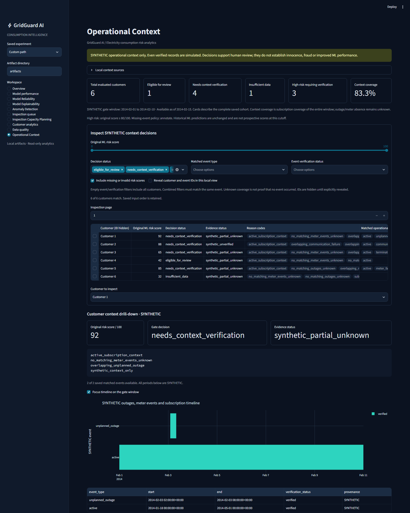
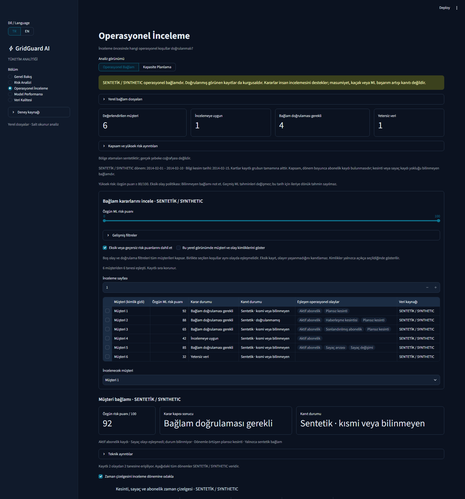

# TR/EN gösterge paneli ve sadeleştirilmiş gezinme

GridGuard AI yeni oturumda **Türkçe** açılır. Kenar çubuğundaki **TR / EN** seçimi, Streamlit yeniden çalıştırmalarında oturum durumunda korunur. Dil seçimi veri dosyalarını, puanları, kararları veya CSV şemalarını değiştirmez.

## Beş bölüm, on analitik görünüm

| Ana bölüm | İçerik / önceki görünüm adı | Kaynak |
| --- | --- | --- |
| **Genel Bakış** / Overview | Genel durum (`Overview`) | Kayıtlı deney ve tahminler |
| **Risk Analizi** / Risk Analysis | İnceleme Listesi (`Inspection queue`), Müşteri Analizi (`Customer analytics`) | Kayıtlı deney; isteğe bağlı yerel tüketim |
| **Operasyonel İnceleme** / Operational Review | Operasyonel Bağlam (`Operational Context`), Kapasite Planlama (`Inspection Capacity Planning`) | Bağlam görünümünde ayrı karar/olay dizinleri; kapasitede seçilen deney |
| **Model Performansı** / Model Performance | Değerlendirme Özeti (`Model performance`), Model Güvenilirliği (`Model Reliability`), Anomali Tespiti (`Anomaly Detection`), Model Açıklanabilirliği (`Model Explainability`) | Ayrı kayıtlı değerlendirme raporları |
| **Veri Kalitesi** / Data Quality | Deney örneklemi, kaynak denetimi ve grup raporları (`Data quality`) | Deney metaverisi ve isteğe bağlı toplu raporlar |

Bir ana bölümde birden çok görünüm varsa üstteki bağlamsal seçimden geçiş yapılır. Hiçbir analitik yetenek kaldırılmadı. Geçmiş deneyler, geliştirme grupları ve operasyonel bağlam dosyaları **birleştirilmez**. Kapasite planlama her zaman seçilen deneyin tamamına dayanır; bağlam listesinin filtreleri kapasite hesabına taşınmaz.

## Çalıştırma ve eski ayarlarla uyumluluk

```powershell
python -m pip install -e ".[app,dev]"
$env:GRIDGUARD_ARTIFACT_DIR = 'artifacts/pipeline-final-20261111'
streamlit run app/streamlit_app.py --server.address 127.0.0.1 --server.port 8501
```

Varsayılan başlangıç Genel Bakış'tır. `GRIDGUARD_WORKSPACE` önceki İngilizce görünüm adlarını kabul etmeye devam eder; örneğin `Operational Context` doğru ana bölümü ve alt görünümü açar. `GRIDGUARD_ARTIFACT_DIR`, `GRIDGUARD_CONTEXT_*`, `GRIDGUARD_RELIABILITY_REPORT`, `GRIDGUARD_ANOMALY_REPORT` ve `GRIDGUARD_EXPLAINABILITY_REPORT` ayarları korunur. [Kaynakları kurma ve güvenli dosya sınırları](operational-context-dashboard.md) değişmedi.

**Deney kaynağı** kenar çubuğunda kapalı bir paneldedir. Operasyonel Bağlam, **Yerel bağlam dosyaları** panelinden bağımsız olarak yüklenir. Dosyalar eksikse boş durum açıklaması gösterilir; bir isteğe bağlı görünümün eksik olması diğer bölümleri engellemez. Kısmi olay dosyalarında kayıtlı kararlar korunur ve kanıtın bilinmediği belirtilir.

## Daha az yoğun sunum

- Sayfa başlıkları bir iş sorusunu yanıtlar. Genel bakış, ayrıntılı model parametrelerini ilk ekrana taşımaz.
- Operasyonel bağlamda dört temel karar kartı öndedir; yüksek risk ve kapsam ayrıntıları ayrıca açılır. Karar kartları kayıtlı grubun tamamını gösterir; filtreler bunları yeniden tanımlamaz.
- Gelişmiş bağlam filtreleri, ayrıntılı kanıt sütunları ve ham karar kodları isteğe bağlıdır. Gerekçelerin okunabilir karşılıkları gösterilir; özgün kodlar teknik panelde korunur.
- AP, ROC-AUC, kesinlik, duyarlılık, lift, Brier ve ECE için kısa açıklamalar vardır. AP, trapez PR-AUC değildir.
- Eşik/grup/dağılım tanıları, kalibrasyon ayrıntıları, yöntem bilgisi ve varsayımsal finansal hesaplamalar kapalı panellerde erişilebilir. Yalnızca seçilen görünüm çalışır; gizli bir panelde model eğitimi veya tahmini yapılmaz.
- Büyük tablolar en çok 200 satırlık sayfalarla gösterilir. Müşteri seçimleri sınırlı tutulur. Kimliklerin açıkça gösterilmesi ve mevcut özel CSV indirmeleriyle ilgili gizlilik korumaları korunur.

## Çeviri yapısı

`src/gridguard/translations.json`, arayüz metinlerini ortak anahtar altında `tr` ve `en` karşılıklarıyla saklar. Türkçe bir metin ekleyip İngilizceyi eksik bırakmak testlerde hatadır. Şablon parametreleri iki dilde eşleşmelidir. `i18n.py`, yalnızca sunum için çeviri, okunabilir etiket, sayı biçimi, tablo kopyası ve Plotly kopyası üretir.

Seçim kutuları içte özgün durum/özellik kodlarını tutar, `format_func` ile çevrilmiş etiket gösterir. Görüntüleme kopyalarının başlıkları ve açıklamaları yerelleştirilir; yüklenen veri çerçeveleri, model çıktıları, müşteri kimlikleri, tarihler, dosya adları, ortam değişkenleri ve CLI parametreleri değişmez. Resmi CSV indirmeleri özgün veri üzerinden mevcut şemayla üretilir. Ham durum ve gerekçe kodları teknik incelemede erişilebilirdir.

Plotly başlıkları, eksenler, açıklamalar, kategoriler ve ilgili bilgi balonları yerelleştirilir; sayısal diziler değiştirilmez. İç içe liste sütunları açık `object` dtype kullanır; pandas/PyArrow uyumluluğu korunur. Bilinmeyen kütüphane tanıları Türkçe bir yönlendirmeyle ve ayrı özgün teknik ayrıntıyla sunulur; ham hata veya parametre metni yeniden yorumlanmaz.

## Bilimsel ve operasyonel sınırlar

Risk puanı doğrulanmış kaçak kullanım kanıtı değildir. Geçmiş test sonuçları, ileriye dönük veya gerçek operasyonel başarım sayılmaz. Geliştirme kalibrasyonu, anomali karşılaştırması ve açıklanabilirlik raporları tarihsel nihai model değerlendirmesinden ayrıdır.

Operasyonel kayıtlar **SENTETİK / SYNTHETIC** olarak işaretlenir; doğrulanmış görünen olaylar da kurgusaldır. Sentetik bölge kimlikleri gerçek coğrafyayı temsil etmez. Eksik olay kaydı, olay yaşanmadığını kanıtlamaz. Sentetik örtüşmeden doğruluk, kesinlik veya duyarlılık artışı çıkarılmaz.

## Önce ve sonra

Önce: on üst düzey görünüm, İngilizce ve daha yoğun operasyonel ekran. Görsel yalnızca kurgusal test müşterileri içerir:



Sonra: beş bölüm, Türkçe gezinme ve daha az yoğun ana görünüm. Kimlikler kapalıdır; yine yalnızca kurgusal test müşterileri kullanılır:



## Doğrulama

```bash
pytest -q
ruff check .
ruff format --check .
```

Testler; Türkçe başlangıcı, dil geçişi ve kalıcılığını, katalog/şablon bütünlüğünü, on görünümün erişilebilirliğini, Plotly etiketlerini, karar kapısı görünümünü, kısmi kaynakları, salt okunur davranışı ve README bağlantı/komutlarını kapsar. Mevcut analitik testler İngilizce görünümde de korunur. CI'nin güncel ve minimum uyumluluk yapılandırmaları çalıştırılır; ayrıntılı sonuçlar ilgili PR'da belirtilir.

**Bilerek değiştirilmeyenler:** modeller, eğitim protokolü, veri kümeleri, müşteri bölümleri, tahminler, karar kuralları, sıralama, kaynak parmak izleri, tarihsel değerlendirme JSON'ları, çıktı şemaları, CLI komutları ve mevcut bağımlılık sınırları. Üretim dağıtımı yapılmaz; yeni API veya veritabanı eklenmez.
