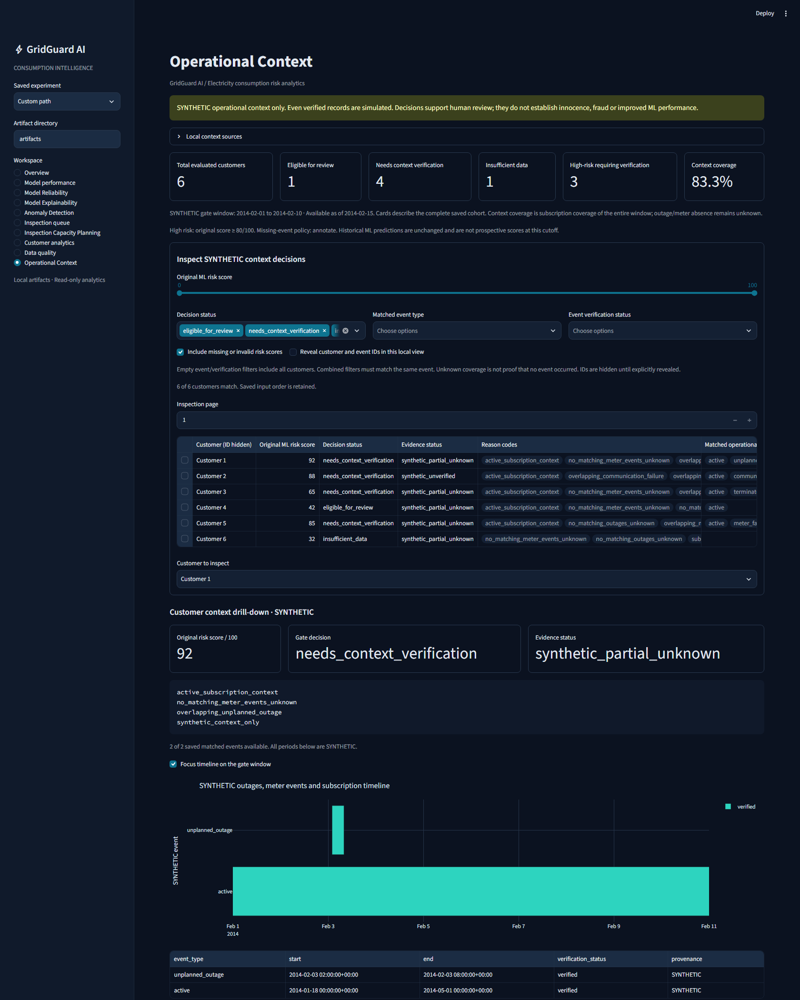

# Operational Context dashboard

The workspace integrates the saved [Phase 1 operational context and decision gate](operational-context.md) into the existing dark dashboard. **Every operational record is SYNTHETIC**, including records marked `verified`. It supports inspection and human review without changing saved ML scores, rankings, training, evaluation or historical artifacts.

## Setup

Use existing output directories if available. Otherwise generate context once from the exact SGCC source and existing predictions; the dashboard itself does not generate events or run model inference:

```powershell
.\.venv\Scripts\python.exe -m pip install -e ".[app,dev]"
.\.venv\Scripts\python.exe -m gridguard.cli generate-context --input data/consumption.csv --reference-metrics artifacts/pipeline-final-20261111/metrics.json --output-dir artifacts/context-sgcc-phase1 --seed 42 --regions 20
.\.venv\Scripts\python.exe -m gridguard.cli context-gate --predictions artifacts/pipeline-final-20261111/test_predictions.csv --context-dir artifacts/context-sgcc-phase1 --evaluation-date 2016-11-07 --window-start 2016-10-01 --window-end 2016-10-31 --output-dir reports/context-sgcc-phase1
$env:GRIDGUARD_CONTEXT_DIR = 'artifacts/context-sgcc-phase1'
$env:GRIDGUARD_CONTEXT_DECISIONS = 'reports/context-sgcc-phase1'
$env:GRIDGUARD_CONTEXT_PREDICTIONS = 'artifacts/pipeline-final-20261111/test_predictions.csv'
$env:GRIDGUARD_CONTEXT_SOURCE = 'data/consumption.csv'
$env:GRIDGUARD_WORKSPACE = 'Operational Context'
.\.venv\Scripts\python.exe -m streamlit run app/streamlit_app.py --server.address 127.0.0.1 --server.port 8501
```

Skip both CLI generation/gate commands when those outputs already exist; they require new/empty destinations. Open `http://localhost:8501` and select **Operational Context** in the sidebar. The optional `GRIDGUARD_WORKSPACE` setting chooses the initial page; the default remains Overview. Expand **Local context sources** to choose local directories and an optional original prediction CSV. The legacy experiment selector does not control this workspace.

| Input | Required files |
| --- | --- |
| Saved gate output directory | `context_decisions.csv`, `context_evaluation.json` |
| SYNTHETIC operational dataset directory | `synthetic_context.json`, `customer_regions.csv`, `outages.csv`, `meter_events.csv`, `subscriptions.csv` |
| Optional original predictions | The CSV whose SHA-256 is recorded in the gate report |
| Optional consumption history | The exact source CSV whose SHA-256 is recorded in the gate report |

There are no new dependencies, database, API, upload flow, estimator loading or writes to input files. Use the Phase 1 schemas unchanged. Customer-level generated files remain local and ignored by Git.

## KPI definitions and filters

The six cards describe the **entire saved cohort**: total customers, eligible for review, needs context verification, insufficient data, high-risk customers requiring verification/more data, and context coverage. High risk uses the recorded gate threshold. **Context coverage is subscription coverage of the entire evaluation window**; it does not establish coverage of outages or meter problems. Filters do not recalculate these full-cohort KPIs.

The table filters by original risk score, decision status, matched event type and verification status. Event type and verification must match the **same event**, so a verified outage does not make an unverified meter fault a verified match. Empty event/verification filters impose no restriction; clearing every decision status yields no customers. Missing/invalid scores can remain visible for insufficient-data review or be excluded explicitly. Customer ID search is literal and available after revealing identifiers.

The server retains the saved decision order. Native table sorting is a local inspection action and never writes rankings. At most 200 filtered rows per page and 200 customer choices are sent to the browser. Select a table row or use **Customer to inspect** to view the original score, saved gate decision, evidence status and reason codes.

## Customer drill-down

The Plotly timeline and evidence table contain saved matched operational events only, checked against exact customer/mapped-region relationships, event overlap and `available_at` at the saved evaluation cutoff. They show planned/unplanned outages, communication failures, meter faults/replacements, and active/terminated subscription periods. UTC timestamp intervals are half-open; date-based source intervals include the entire end day. The view initially focuses on the gate window and can expand to show entire matched periods.

Source consumption loads only after **Load source consumption history** is submitted. The source SHA-256 must match the context report. The existing bounded customer-history loader preserves zeros, missing/invalid readings and calendar gaps. Yellow shading identifies SYNTHETIC outage/meter periods; a second plot shows reading availability. Source readings remain unchanged, and overlap does not demonstrate causation. Ordinary filter changes do not load raw source history.

## Integrity and missing files

`context_dashboard.py` validates schemas, lexical IDs, SYNTHETIC provenance, safe JSON string lists, allowed states, counts, high-risk totals, rates, source fingerprints and population membership. With a complete bundle it replays **only the deterministic post-model gate**, comparing saved statuses, evidence, reasons, matched IDs and aggregate arithmetic. Replay results are never written and no ML prediction, fitting or evaluation function runs.

An optional original prediction CSV verifies its recorded SHA-256 and exact customer order and original risk scores. Without it, score provenance is explicitly **unverified**. These checks establish file consistency, not authenticity of untrusted inputs.

Missing operational CSVs retain saved decisions and KPI totals with a warning that replay integrity is unverified. Missing referenced events appear as **unknown / unresolved evidence**. Missing metadata disables operational event display and replay. No missing record becomes proof of no outage or meter problem. Missing/invalid primary gate outputs or incompatible complete bundles show a recoverable message; other dashboard pages remain available.

## Local paths, privacy and caching

Relative selections resolve against the repository root. For files elsewhere, set **`GRIDGUARD_CONTEXT_ROOT` on the server** to a specific local parent directory containing the required inputs. UI fields cannot broaden this boundary. Absolute paths must also remain inside that root. URLs, network/UNC paths, traversal, alternate streams, protected configuration directories and symlink escapes are rejected. Fixed input filenames and CSV/JSON extensions limit what can be read. Operational/prediction CSVs are limited to 64 MiB each and JSONs to 2 MiB; the larger source-history CSV has no small-artifact limit.

**Customer and event identifiers are hidden by default.** An explicit checkbox reveals them in this local view. Browser frames are allowlisted before serialization, omitting ground truth, private notes, source foreign keys and arbitrary extra fields. There is no new download button. Native table copy/download contains only the displayed fields, so explicitly revealing identifiers also makes them available to native actions. Keep the dashboard on localhost; this is not an authentication/access-control system. Avoid sharing screenshots after revealing real IDs.

The context cache holds at most eight validated views for five minutes, keyed by selected paths and signatures of both gate files, every operational file and the optional prediction CSV. Additions, deletions, mtime and size changes invalidate the key. Paths are checked before cache lookup. Up to sixteen verified customer histories are cached for five minutes, with source signature and expected SHA-256 in each key. No raw source reads occur during ordinary filtering.

## Screenshot and verification



The screenshot uses invented unit-test customers, not real SGCC records. It illustrates interface behavior, not operational performance.

```powershell
.\.venv\Scripts\python.exe -m ruff check .
.\.venv\Scripts\python.exe -m pytest -q
.\.venv\Scripts\python.exe -m pytest tests/test_context_dashboard.py -q
```

Tests cover parsing, exact score/order preservation, gate replay, mixed/tampered files, future evidence, subscription transitions, missing files, literal and same-event filters, hidden identifiers, cache signatures, safe paths/symlink escapes, source-history fingerprints and Streamlit interactions. UI tests block model loading, fitting and inference and check that all consumed files remain unchanged. Existing workspace tests continue to run. Headless-browser verification checks the actual dark layout and timeline using invented customers.

Historical ML scores are not prospective predictions at the context cutoff. Synthetic `verified` evidence is still simulated; no precision, recall, accuracy or operational performance gain is measured or claimed.
